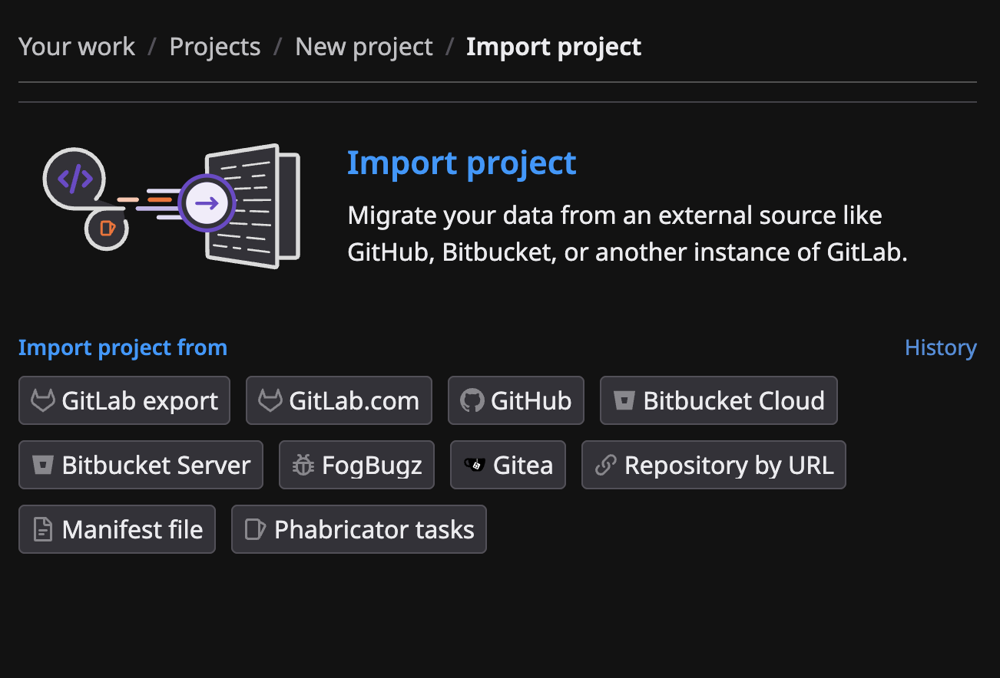
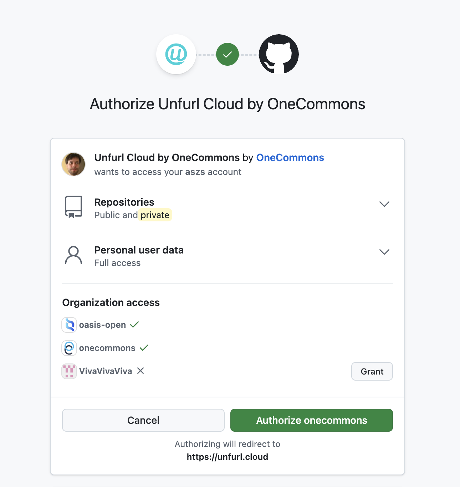
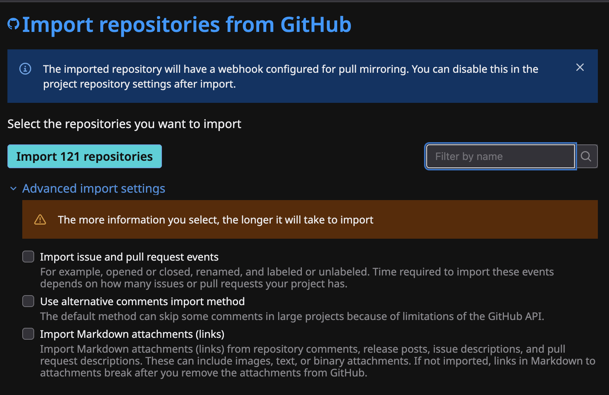
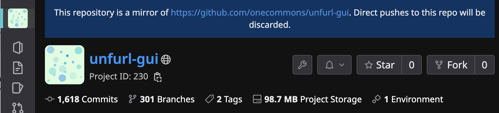
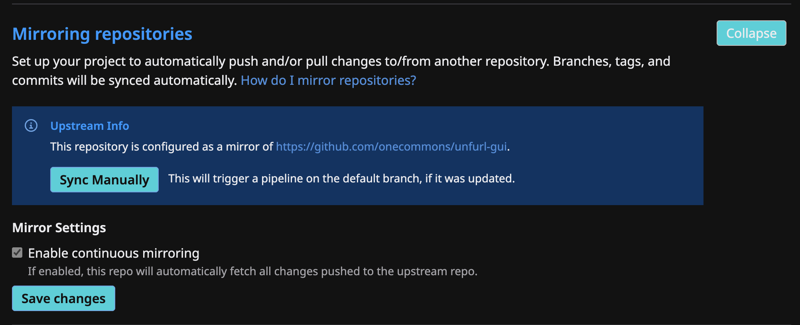

<!-- OC Change -- a fork page: upstream has no GitHub live mirroring.
     Beside the pages that link to it, so the docs link check can resolve it. -->

# Live mirroring from Github

Unfurl Cloud can install a webhook that will automatically push changes from a repository on Github to Unfurl Cloud.

### Import From Github

You need to import the repository from Github. Select **New project**, then **Import project**, then **GitHub**.

If you haven't already connected your Unfurl Cloud account to Github, Github will ask for authorization.

Project imports can include issues, pull requests, labels, etc. See  [prerequisites](../../import/github.md#prerequisites) for guidance on preparing the import.

Imported projects with live mirroring enabled will display a banner at top:

### Live mirror Settings

After the project has been imported, visit **Settings > Repository** to control live mirroring.

Check or uncheck the **Enable continuous mirroring** checkbox to enable or disable live mirroring of the upstream repository.

The **Sync Manually** button will trigger a fetch of the latest changes to the upstream git repository on Github.

