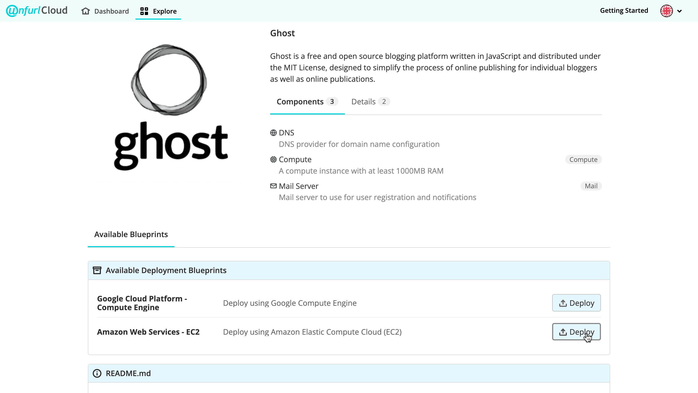
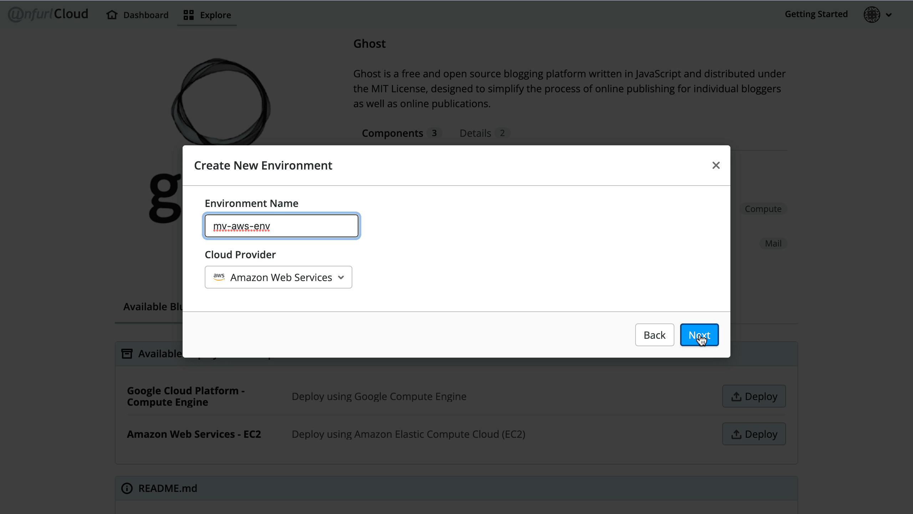
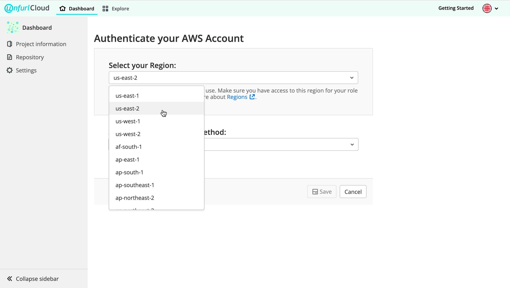
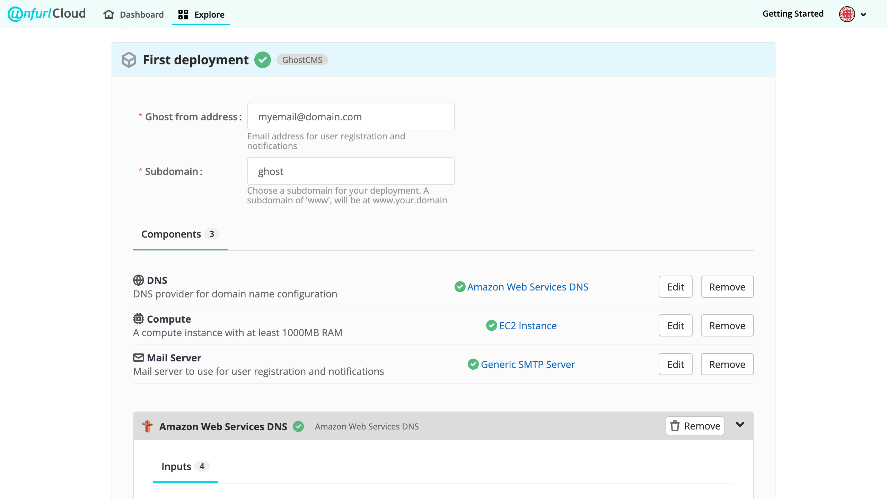

**On This Page**

 [[_TOC_]]

### Deploy your first application with Unfurl Cloud

Unfurl Cloud provides a catalog of **Application Blueprints**, which package together an application and the necessary configuration files to quickly and easily deploy it with your cloud provider. Our technology integrates with poplar DevOps tools like Ansible and Terraform under the hood, and provides version control for your configurations and deployments so that you can review, recreate, and alter deployments as needed.

This guide will walk through deploying [Ghost](https://ghost.org/) onto Amazon Web Services (AWS) using Unfurl Cloud.

**Prerequisites:** AWS account

**Optional:** Preferred DNS server

### Select the Application Blueprint for Ghost

1. Select **Explore** in the Top Navigation Bar.

2. Scroll through the Application Blueprints and select **Ghost**.

### Select a Deployment Blueprint

**Deployment Blueprints** allow you to quickly configure your deployment, including adding external resources or creating managed resources. In the "Available Blueprints" section, find "Amazon Web Services" and click "Deploy". 

### Set up an Environment

To deploy with Unfurl Cloud, you must set up an **Environment** associated with your cloud provider. 

1. Name your deployment.
2. Click the **Select** dropdown and select **Create new environment**, then click **Next**.

3. Name your environment, then click **Next**.

4. Select an **AWS Region** and Authenticate your AWS account** 
- Select a **region** from the dropdown list. 

- Select an **authentication method**:
   1. *Enter an AWS access key.* To generate a key, follow [these instructions](https://aws.amazon.com/premiumsupport/knowledge-center/create-access-key/).
   2. *Create a Role ARN using AWS Stack.* Once you've selected this option from the dropdown menu, follow the instructions that appear. 
   3. *Create a Role ARN manually.* Follow the instructions [here](https://unfurl.cloud/help/user/project/clusters/add_eks_clusters.md#create-another-eks-iam-role-for-gitlab-authentication-with-amazon), and paste the generated Role ARN in the **Enter your Role ARN** field. 

5. Click **Save**.

### Configure resources

1. Provide values for required **inputs** 

2. Create **resources** 
   Deployment Blueprints are designed to dramatically reduce the time and effort required to deploy while making it as easy as possible to customize your deployment. This is where **resources** come in. Each application blueprint lists the resources required to deploy that application, and each deployment blueprint gives you a flexible framework to fulfill those requirements in your environment (in this example, an AWS environment). 

   Under **Components** for Ghost, you will see the following resources:
   - DNS
   - Compute
   - Mail Server
    

   To configure these resources, select **Create** next to the resource name and follow the prompts. 

   When you have provided the required inputs for a resource, you will see a green check mark next to the resource's name. Once you have configured each required resource and see a green check mark next to each of them, you are ready to deploy.
   

### Click "Deploy"

Once you’ve deployed, you will see the log (after a few minutes), and you can check on your deployment in your dashboard.

 ---