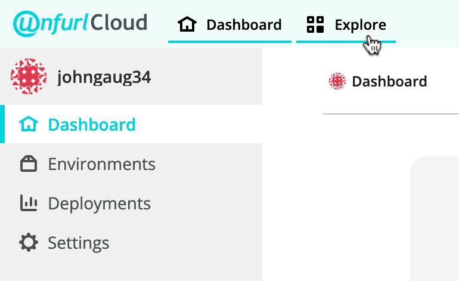
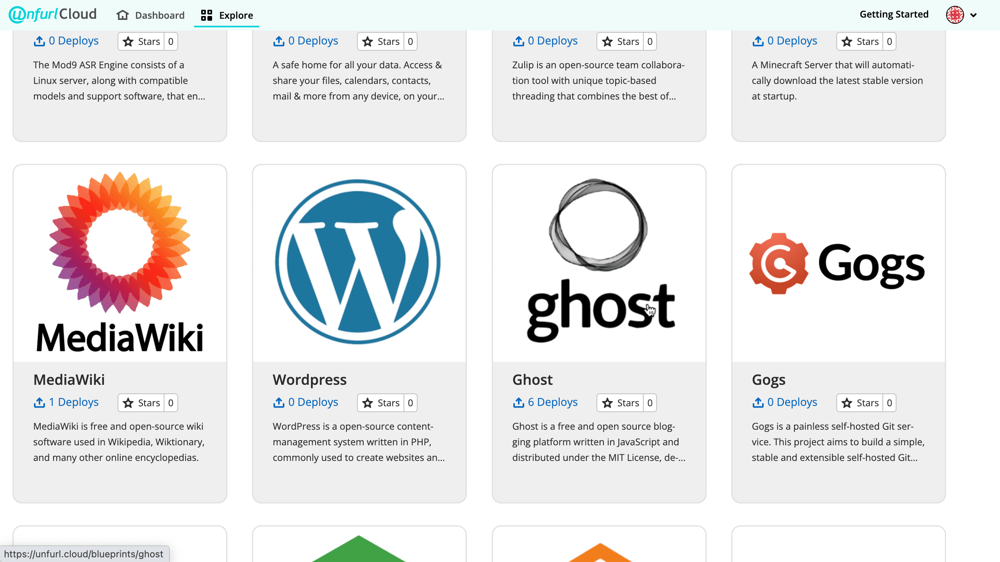
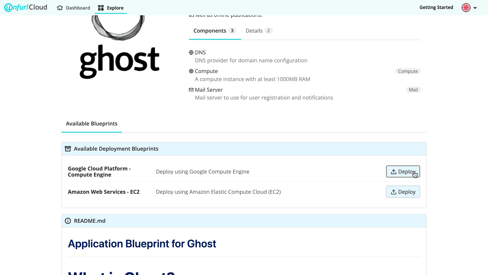
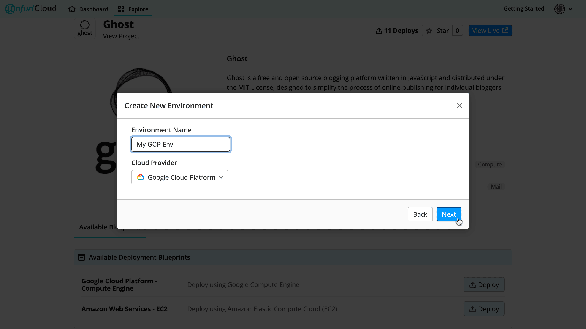
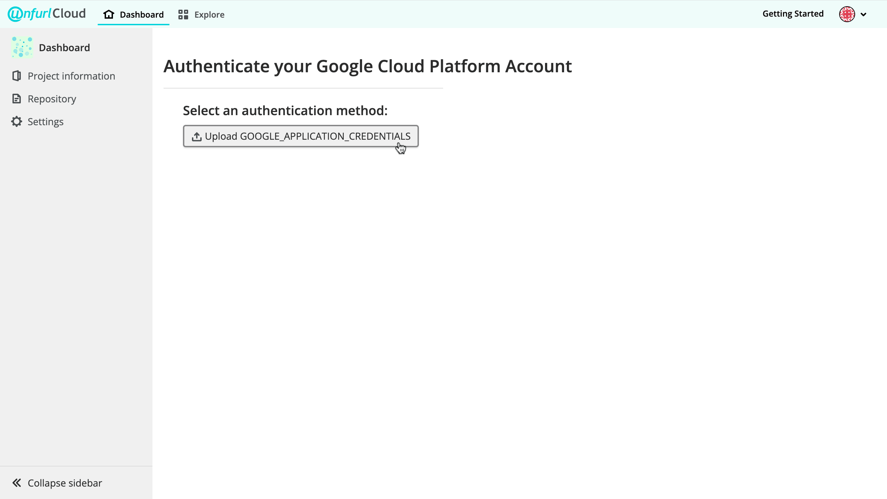
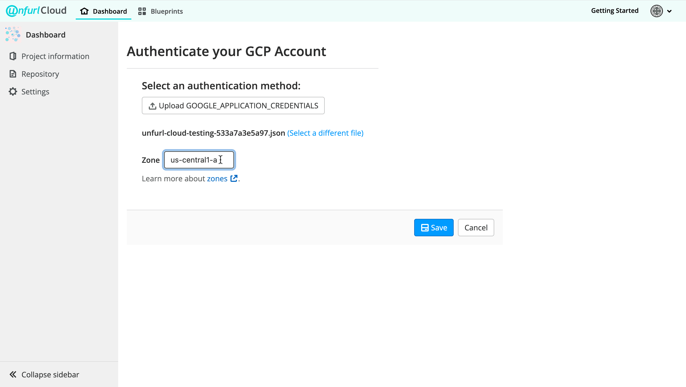
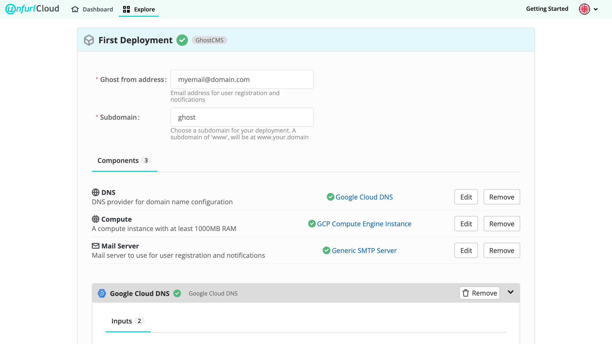

## Getting Started with Unfurl Cloud:   Google Cloud Platform

**On This Page**

 [[_TOC_]]

### Deploy your first application with Unfurl Cloud

Unfurl Cloud provides a catalog of **Application Blueprints**, which package together an application and the necessary configuration files to quickly and easily deploy it with your cloud provider. Our technology integrates with poplar DevOps tools like Ansible and Terraform, and provides version control for your configurations and deployments so that you can review, recreate, and alter them as needed.

This guide will walk through deploying [Ghost](https://ghost.org/) onto Google Cloud Platform (GCP) using Unfurl Cloud.

**Prerequisites:** GCP account

**Optional:** MongoDB Atlas account, preferred DNS server

### Select the Application Blueprint for Ghost

1. Select **Explore** in the Top Navigation Bar.

2. Scroll through the Application Blueprints and select **Ghost**.

### Select a Deployment Blueprint

**Deployment Blueprints** allow you to quickly configure your deployment, including adding external resources or creating managed resources. In the **Available Blueprints** section, find **Google Cloud Platform** and click **Deploy**. 

### Set up an Environment

To deploy with Unfurl Cloud, you must set up an **Environment** associated with your cloud provider. 

1. Name your deployment.
2. Click the **Select** dropdown and select **Create new environment**, then click **Next**.

3. Name your environment, then click **Next**.

4. Create a GCP project and authenticate your GCP account. 
The current page will prompt you to upload **GOOGLE_APPLICATION_CREDENTIALS**.

This is a JSON file that you can generate in the GCP console. To do so:
   - Create a **GCP Project**
      - Your Unfurl Cloud GCP environment must be associated with a [GCP project](https://cloud.google.com/storage/docs/projects). Setting up a project is easy and quick--[these instructions from GCP](https://developers.google.com/workspace/marketplace/create-gcp-project#:~:text=A%20Google%20Cloud%20Platform%20%28GCP,and%20what%20resources%20it%20uses.) will show you how. 
   - Create a **service account** and **service account key** within your new GCP project
      - GCP service accounts are a means of authenticating and authorizing access to your GCP data via Google APIs. [Follow these instructions from GCP](https://cloud.google.com/docs/authentication/provide-credentials-adc) to create a service account and generate a service account key (this is the GOOGLE_APPLICATION_CREDENTIALS JSON file you need to upload to Unfurl Cloud)  

   Once you've generated a service account key, download it from the GCP console and upload it to Unfurl Cloud. 

5. Select a **GCP zone**. 
Once you have uploaded a valid service account key, you will need to enter a valid zone. (For an explanation of GCP zones and a complete list of available zones, find **Learn more about zones** and click on the link.) 

6. Click **Save**.

### Configure resources

1. Provide values for **inputs** 

2. Create **resources** 
   Deployment Blueprints are designed to dramatically reduce the time and effort required to deploy while making it as easy as possible to customize your deployment. This is where **resources** come in. Each application blueprint lists the resources required to deploy that application, and each deployment blueprint gives you a flexible framework to fulfill those requirements in your environment (in this example, a GCP environment). 

   Under **Components** for Ghost, you will see the following resources:
   - DNS
   - Compute
   - Mail Server
    

   To configure these resources, select **Create** next to the resource name and follow the prompts. 

   When you have provided the required inputs for a resource, you will see a green check mark next to the resource's name. Once you have configured each required resource and see a green check mark next to each of them, you are ready to deploy.
   

### Click "Deploy"

Once you’ve deployed, you will see the log (after a few minutes), and you can check on your deployment in your dashboard.

 ---
